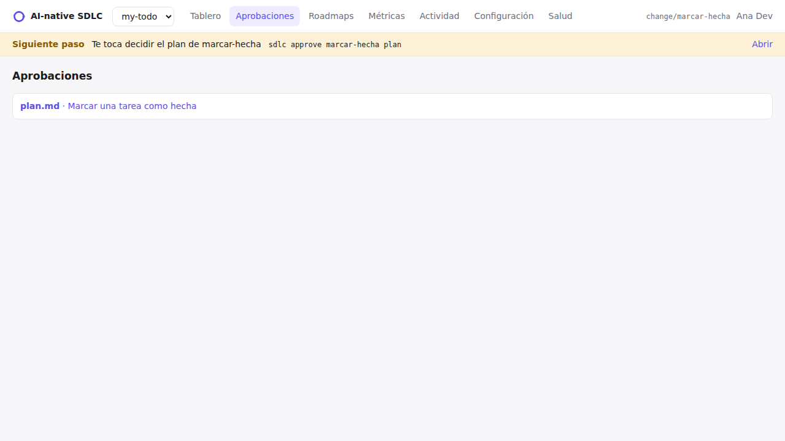
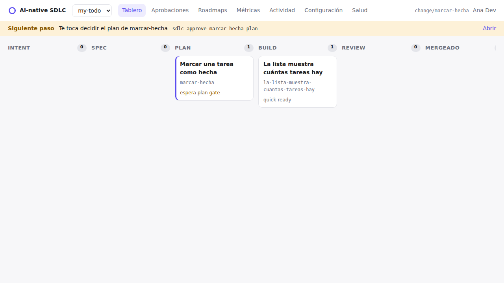

# Tutorial: tu primer cambio

Unos 20 minutos. Vas a hacer dos cambios en la app de tareas de ejemplo de [Instalar](./instalar.md):

1. Un **cambio chico** por el carril rápido: la lista muestra cuántas tareas hay.
2. Una **funcionalidad de verdad** por el loop completo: marcar una tarea como hecha.

Cada paso dice qué escribís, qué deberías ver y qué hacer si ves otra cosa. Los comandos que empiezan con `npx sdlc` van en la terminal. Los que empiezan con `/` van en el chat del agente.

::: tip Abrir el agente
**Claude Code:** en la terminal, dentro de la carpeta del proyecto, corré `claude`. **Cursor:** abrí la carpeta del proyecto (File → Open Folder) y abrí el chat del agente (Cmd+L o Ctrl+L). Dejá una segunda terminal abierta para los comandos `npx sdlc`.
:::

## Parte 1: un cambio chico (carril rápido)


### Paso 1. Decí qué querés

```bash
npx sdlc quick "La lista muestra cuántas tareas hay"
```

Deberías ver:

```text
created changes/2026-11-la-lista-muestra-cuantas-tareas-hay/intent.md on branch change/la-lista-muestra-cuantas-tareas-hay (quick lane: no spec, no plan)
Next: /sdlc-quick in your agent. Limits on push: 10 code files, no high-risk paths (sdlc quick --check).
```

La herramienta creó una carpeta para el cambio y te pasó a una rama de git nueva. Tu rama `main` queda intacta.

### Paso 2. Dejá que lo haga el agente

En el chat del agente:

```text
/sdlc-quick
```

El agente lee el cambio, actualiza el test, cambia `src/todos.js` y corre `npm test`. Cuando termina, commitea. La primera vez puede pedirte permiso para correr un comando: leelo y permitilo.

**Verificalo vos:**

```bash
npm test                          # pasan todos los tests
node src/cli.js add "comprar leche"
node src/cli.js list              # 1. comprar leche, y abajo (1 to-dos)
npx sdlc quick --check            # ok: 2/10 code files, no high-risk paths
```

`quick --check` confirma que el cambio sigue siendo chico. Si pasa de 10 archivos de código o toca una ruta riesgosa, la herramienta te pide pasarlo al loop completo con `npx sdlc promote`.

### Paso 3. Terminalo

Con GitHub: en el chat del agente, `/sdlc-ship`. Sube la rama y abre el pull request; lo mergeás en GitHub.

Sin GitHub (este tutorial): mergealo vos.

```bash
git checkout main
git merge change/la-lista-muestra-cuantas-tareas-hay
```

## Parte 2: una funcionalidad de verdad (el loop completo)


### Paso 4. Empezá el cambio

```bash
npx sdlc new marcar-hecha --title "Marcar una tarea como hecha"
```

```text
created changes/2026-11-marcar-hecha/intent.md on branch change/marcar-hecha
Next: fill it with your agent (/sdlc-intent) and ask the PO to accept it (sdlc approve).
```

De acá en adelante, cada vez que no sepas qué hacer, corré `npx sdlc next`. Siempre da una sola respuesta.

### Paso 5. El intent: qué problema resolvemos

En el chat del agente, contalo con tus palabras:

```text
/sdlc-intent Cuando agrego una tarea queda para siempre. Quiero marcarla como hecha y ver un tilde en la lista. Los archivos viejos tienen que seguir funcionando.
```

El agente escribe `changes/2026-11-marcar-hecha/intent.md` y lo commitea. **Abrí el archivo y leelo.** Tiene que describir el problema, no el código. Después:

```bash
npx sdlc next
```

```text
Te toca decidir el intent de marcar-hecha → sdlc approve marcar-hecha intent
```

```bash
npx sdlc approve marcar-hecha intent -m "dale"
```

```text
changes/2026-11-marcar-hecha/intent.md approved by Tu Nombre (4a735cf)
```

Esa aprobación es un commit de git con tu nombre. Si no estás de acuerdo, usá `npx sdlc reject marcar-hecha intent -m "por qué"` y pedile al agente que lo corrija.

### Paso 6. La spec: qué se construye exactamente

```text
/sdlc-spec
```

El agente escribe `spec.md`: una lista de requisitos (R1, R2…) que se pueden verificar uno por uno, y *areas of concern* como "¿qué pasa con los archivos viejos?". **Es el contrato**: leé los requisitos con atención. Después:

```bash
npx sdlc approve marcar-hecha spec
```

### Paso 7. El plan: cómo se construye

```text
/sdlc-plan
```

En Claude Code, primero pasá a plan mode (Shift+Tab hasta que diga "plan mode"): el agente puede leer pero no cambiar nada. El plan lista los archivos que cambian, el orden del trabajo y los tests. Preguntá en el chat hasta que te quede claro, y después:

```bash
npx sdlc approve marcar-hecha plan
```

::: warning El código antes del plan se bloquea
Si alguien (agente o persona) intenta subir código en `change/marcar-hecha` antes de que el plan esté aprobado, git lo frena:

```text
Bloqueado por ai-sdlc: la rama change/marcar-hecha tiene cambios de código pero changes/2026-11-marcar-hecha/plan.md no está aprobado (etapa: spec-approved). Plan antes que código: …
```

Es el guardrail haciendo su trabajo. Aprobá el plan primero.


:::

### Paso 8. Construilo

```text
/sdlc-build
```

El agente escribe primero los tests, después el código, paso a paso, y corre `npm test` después de cada uno. Cuando termina:

```bash
npm test                     # pasan 6 tests
node src/cli.js add "comprar leche"
node src/cli.js done 1
node src/cli.js list         # 1. [x] comprar leche
```

### Paso 9. Mandalo

Con GitHub, `/sdlc-ship` abre el pull request con un resumen, cómo se probó, el riesgo y cómo revertirlo. Sin GitHub, mergeá como en el paso 3:

```bash
git checkout main && git merge change/marcar-hecha
```

## Miralo en el dashboard

```bash
npx sdlc ui
```

Abre `http://127.0.0.1:4319` en tu navegador. No sale nada de tu máquina.



- **Aprobaciones**: lo que espera tu decisión. Los botones de aprobar y rechazar hacen lo mismo que `npx sdlc approve`.
- **Tablero**: todos los cambios y en qué etapa está cada uno.
- **Cambio** (al abrir uno): intent, spec y plan uno al lado del otro, con su historial.



## Lo que acabás de hacer

- Dos cambios, cada uno con una carpeta en `changes/` que dice por qué se hizo y quién lo aprobó.
- No se escribió código antes de que estuvieras de acuerdo con el plan.
- El agente no pudo aprobar nada por vos.

Siguiente: [Uso diario](./dia-a-dia.md), un machete para tu propio proyecto.
