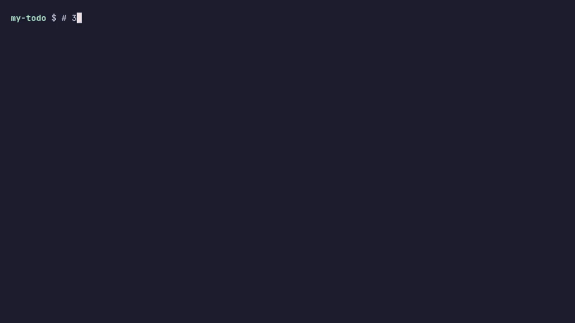
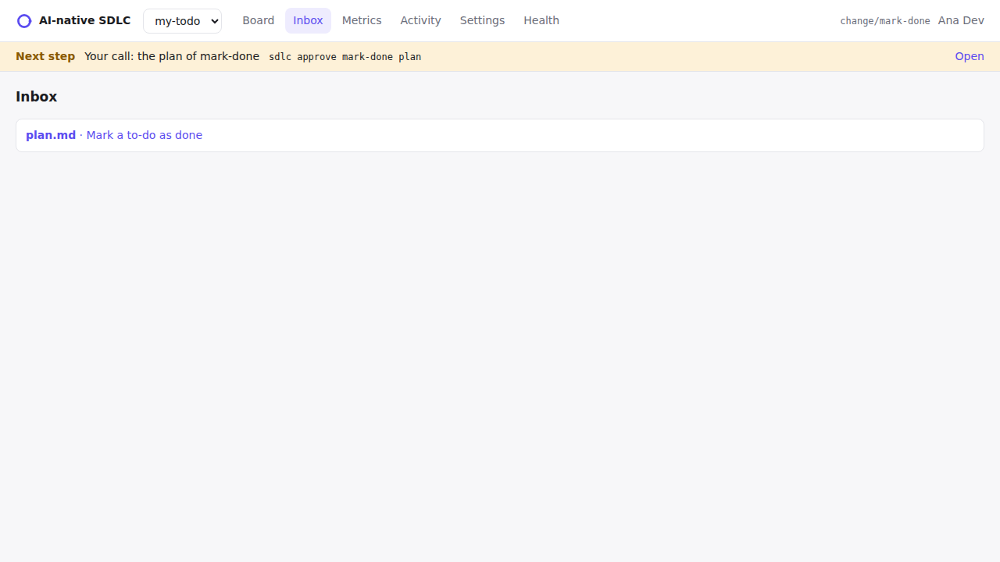
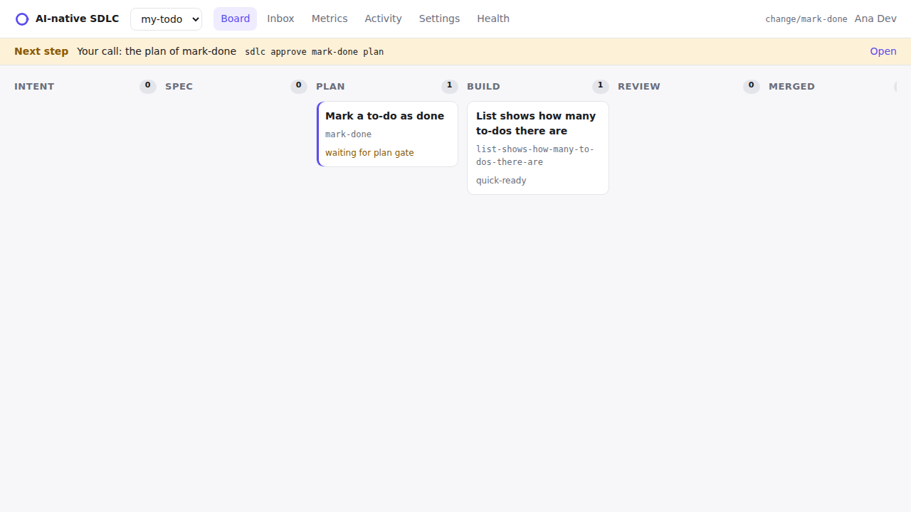

# Tutorial: your first change

About 20 minutes. You will make two changes to the example to-do app from [Install](./install.md):

1. A **small change** through the quick lane: the list shows how many to-dos there are.
2. A **real feature** through the full loop: mark a to-do as done.

Each step says what you type, what you should see, and what to do if you see something else. Commands that start with `npx sdlc` go in the terminal. Commands that start with `/` go in your agent's chat.

::: tip Opening the agent
**Claude Code:** in the terminal, inside the project folder, run `claude`. **Cursor:** open the project folder (File → Open Folder) and open the agent chat (Cmd+L or Ctrl+L). Keep a second terminal open for the `npx sdlc` commands.
:::

## Part 1: a small change (quick lane)


### Step 1. Say what you want

```bash
npx sdlc quick "List shows how many to-dos there are"
```

You should see:

```text
created changes/2026-11-list-shows-how-many-to-dos-there-are/intent.md on branch change/list-shows-how-many-to-dos-there-are (quick lane: no spec, no plan)
Next: /sdlc-quick in your agent. Limits on push: 10 code files, no high-risk paths (sdlc quick --check).
```

The tool created a folder for the change and switched to a new git branch for it. Your `main` branch is untouched.

### Step 2. Let the agent do it

In the agent chat:

```text
/sdlc-quick
```

The agent reads the change, updates the test, changes `src/todos.js` and runs `npm test`. When it finishes it commits. It may ask you to allow a command the first time: read it and allow it.

**Check it yourself:**

```bash
npm test                          # all tests pass
node src/cli.js add "buy milk"
node src/cli.js list              # 1. buy milk, then (1 to-dos)
npx sdlc quick --check            # ok: 2/10 code files, no high-risk paths
```

`quick --check` confirms the change is still small. If it grows past 10 code files or touches a risky path, the tool asks you to move it to the full loop with `npx sdlc promote`.

### Step 3. Finish it

With GitHub: in the agent chat, `/sdlc-ship`. It pushes the branch and opens the pull request; you merge it on GitHub.

Without GitHub (this tutorial): merge it yourself.

```bash
git checkout main
git merge change/list-shows-how-many-to-dos-there-are
```

## Part 2: a real feature (the full loop)



### Step 4. Start the change

```bash
npx sdlc new mark-done --title "Mark a to-do as done"
```

```text
created changes/2026-11-mark-done/intent.md on branch change/mark-done
Next: fill it with your agent (/sdlc-intent) and ask the PO to accept it (sdlc approve).
```

From now on, whenever you are not sure what to do, run `npx sdlc next`. It always gives one answer.

### Step 5. The intent: what problem we are solving

In the agent chat, explain it in your own words:

```text
/sdlc-intent Once I add a to-do it stays forever. I want to mark one as done and see a tick in the list. Old files must keep working.
```

The agent writes `changes/2026-11-mark-done/intent.md` and commits it. **Open the file and read it.** It should describe the problem, not the code. Then:

```bash
npx sdlc next
```

```text
Your call: the intent of mark-done → sdlc approve mark-done intent
```

```bash
npx sdlc approve mark-done intent -m "go"
```

```text
changes/2026-11-mark-done/intent.md approved by Your Name (909a7d8)
```

That approval is a git commit with your name on it. If you disagree, use `npx sdlc reject mark-done intent -m "why"` and ask the agent to fix it.

### Step 6. The spec: what exactly will be built

```text
/sdlc-spec
```

The agent writes `spec.md`: a list of requirements (R1, R2…) that can each be checked, and *areas of concern* such as "what happens with old files?". **This is the contract**: read the requirements carefully. Then:

```bash
npx sdlc approve mark-done spec
```

### Step 7. The plan: how it will be built

```text
/sdlc-plan
```

In Claude Code, switch to plan mode first (Shift+Tab until it says "plan mode"): the agent can read but not change anything. The plan lists the files that change, the order of the work and the tests. Ask questions in the chat until it is clear, then:

```bash
npx sdlc approve mark-done plan
```

::: warning Code before the plan is blocked
If someone (agent or person) tries to push code on `change/mark-done` before the plan is approved, git stops it:

```text
Blocked by ai-sdlc: branch change/mark-done has code changes but changes/2026-11-mark-done/plan.md is not approved (stage: spec-approved). Plan before code: …
```

That is the guardrail doing its job. Approve the plan first.


:::

### Step 8. Build it

```text
/sdlc-build
```

The agent writes the tests first, then the code, step by step, running `npm test` after each one. When it is done:

```bash
npm test                     # 6 tests pass
node src/cli.js add "buy milk"
node src/cli.js done 1
node src/cli.js list         # 1. [x] buy milk
```

### Step 9. Ship it

With GitHub, `/sdlc-ship` opens the pull request with a summary, how it was tested, the risk and how to revert. Without GitHub, merge as in step 3:

```bash
git checkout main && git merge change/mark-done
```

## See it in the dashboard

```bash
npx sdlc ui
```

It opens `http://127.0.0.1:4319` in your browser. Nothing leaves your machine.



- **Inbox**: what is waiting for your decision. The approve and reject buttons do the same as `npx sdlc approve`.
- **Board**: every change and the stage it is at.
- **Change** (when you open one): intent, spec and plan side by side, with their history.



## What you just did

- Two changes, each with a folder in `changes/` that says why it was made and who approved it.
- No code was written before you agreed with the plan.
- The agent could not approve anything for you.

Next: [Everyday use](./daily.md), a cheat sheet for your own project.
